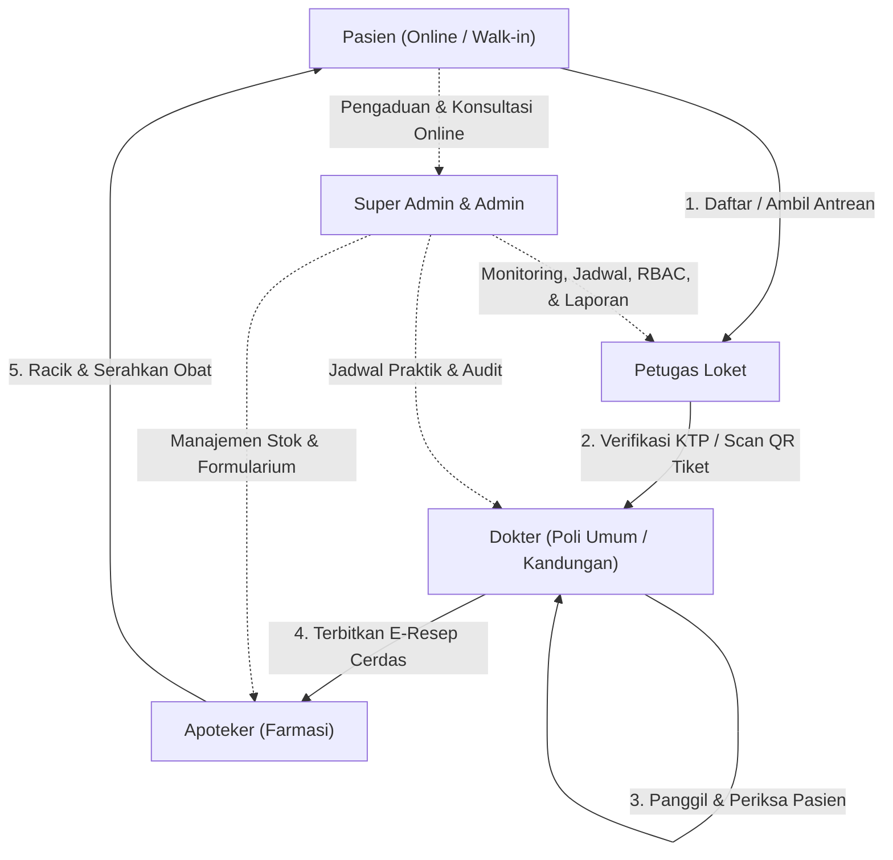

# Puskesmas Sehat — Sistem Informasi Pelayanan Puskesmas

Laravel 13 · PHP 8.4 · MySQL 8 (Laragon) · OpenAPI/Swagger · Tema gelap & terang

Dibangun dari **ERD_Puskesmas_Chen.xlsx** (Akun, Peran, Izin, Log_login, Pasien, Dokter, Spesialisasi, Apoteker, Admin, Konsultasi, Resep, Detail_resep, Obat, Penyerahan_obat). Navigasi, kartu "Apa yang ingin Anda lakukan?", dan toast alert mengikuti gaya PRISMA. Pemisahan layout publik real-time tanpa data pribadi mengikuti pola Zavora.

## Menjalankan di Laragon

1. Taruh folder ini di `C:\laragon\www\puskesmas` (atau biarkan di sini lalu jalankan `php artisan serve`).
2. Laragon → **Start All** (MySQL harus jalan).
3. Buat database dan isi data awal:

```bash
mysql -uroot -e "CREATE DATABASE IF NOT EXISTS puskesmas CHARACTER SET utf8mb4 COLLATE utf8mb4_unicode_ci"
```

```bash
php artisan migrate:fresh --seed
```

4. Buka `http://puskesmas.test` (virtual host Laragon) atau:

```bash
php artisan serve
```

lalu `http://localhost:8000`.

Database `puskesmas` langsung terlihat di HeidiSQL/phpMyAdmin Laragon. Pengaturan koneksi ada di `.env` (`DB_DATABASE=puskesmas`, user `root`, tanpa sandi).

## Login & 7 Peran Pengguna

Tidak ada akun demo di halaman login. Semua peran masuk dari **gateway tunggal** `/login` (username **atau** email, password dengan tombol tampil/sembunyi, *Ingat saya*, *Lupa password?*, dan verifikasi captcha hitung). Versi kartu ringkas untuk alur pasien ada di `/pasien/masuk` (endpoint sama). **Registrasi mandiri hanya untuk pasien** (`/register`); akun seluruh staf dibuat dan dikelola oleh Super Admin.

| Username | Peran | Poli / Unit Kerja | Deskripsi Tugas Utama |
|---|---|---|---|
| `superadmin` | Super Admin | Pimpinan & IT Puskesmas | Otoritas penuh sistem, kelola akun staf, RBAC, audit, & pengaturan faskes |
| `admin` | Admin Puskesmas | Tata Usaha & Operasional | Jadwal praktik, pengumuman, tanggapan aduan, kirim alert, & laporan |
| `dr.umum`, `dr.umum2` | Dokter Umum | Poli Umum | Pemanggilan antrean poli, pemeriksaan fisik, diagnosis, & resep digital |
| `dr.kandungan` | Dokter Kandungan | Poli Kandungan / KIA | Pemeriksaan ANC/kehamilan, resep aman bumil, & konsultasi KIA |
| `apoteker` | Apoteker / Farmasi | Instalasi Farmasi | Penerimaan resep digital, peracikan, penyerahan obat, & stok obat |
| `loket` | Petugas Loket | Pendaftaran & Front Office | Registrasi walk-in, pencarian No. RM, check-in QR (HMAC), & pantau antrean |
| `pasien` | Pasien | Pengguna Layanan | Daftar berobat online, e-tiket QR, pantau antrean, resep, avatar profil |

Kata sandi awal **berbeda untuk tiap peran** dan dibaca seeder dari `.env` (`SEED_PASSWORD_SUPER_ADMIN`, `…_ADMIN`, `…_DOKTER_UMUM`, `…_DOKTER_KANDUNGAN`, `…_APOTEKER`, `…_LOKET`, `…_PASIEN`). Ganti setelah login pertama lewat **Profil**. Jika `.env` baru disalin dari `.env.example`, isi dulu nilai-nilai tersebut (min. 8 karakter) sebelum `migrate --seed`.

---

## Rincian Peran Dokter, Staf, & Pasien

### 1. Super Admin (Pimpinan Puskesmas & Administrator Sistem)
- **Akun Bawaan:** `superadmin`
- **Tanggung Jawab:**
  - **Kelola Akun Staf:** Membuat akun baru dokter, apoteker, loket, dan admin; mengatur status aktif/nonaktif, serta membuka blokir akun yang terkunci akibat salah sandi.
  - **Manajemen RBAC (Role-Based Access Control):** Mengatur hak akses dan izin granular per peran melalui menu **Peran & Izin**.
  - **Audit & Keamanan:** Memantau seluruh jejak aktivitas pengguna (*Audit Log*), histori login staf/pasien, pengunduhan data pasien, dan akses dokumen privat (foto KTP).
  - **Pengaturan Puskesmas:** Mengonfigurasi identitas faskes (nama puskesmas, kode faskes, alamat, no. telepon, logo, serta nama & NIP Kepala Puskesmas untuk tanda tangan laporan resmi).
  - **Template Notifikasi & Komunikasi:** Mengatur template pesan WhatsApp dan notifikasi internal untuk setiap langkah alur pelayanan.
  - **Laporan Komprehensif:** Mengakses dan mengekspor laporan bulanan kunjungan, poli, dokter, dan pemakaian obat dalam format Excel (.xlsx) dan PDF resmi.

### 2. Admin Puskesmas (Tata Usaha & Operasional Harian)
- **Akun Bawaan:** `admin`
- **Tanggung Jawab:**
  - **Jadwal Praktik Dokter:** Menentukan jadwal dinas dokter umum dan dokter kandungan (hari praktik, jam mulai, jam selesai, dan kuota pasien harian).
  - **Pengumuman Publik:** Mempublikasikan informasi kesehatan, jadwal libur pelayanan, atau agenda vaksinasi/posyandu ke beranda publik.
  - **Pengelolaan Pengaduan Masyarakat:** Memproses keluhan pasien, menugaskan tindak lanjut, dan memberikan tanggapan resmi atas aduan layanan.
  - **Kirim Alert Darurat:** Mengirimkan notifikasi darurat/siaran khusus (*broadcast alert*) ke seluruh petugas puskesmas atau peran tertentu.
  - **Laporan Operasional:** Memantau statistik kunjungan dan mengunduh berkas laporan bulanan faskes.

### 3. Dokter Umum (Poli Umum)
- **Akun Bawaan:** `dr.umum`, `dr.umum2`
- **Tanggung Jawab:**
  - **Antrean Poli Real-Time:** Melihat daftar pasien Poli Umum yang telah melakukan check-in di loket.
  - **Panggilan Pasien:** Memanggil nomor antrean berikutnya (suara panggilan dan nomor antrean langsung terupdate di layar monitor ruang tunggu).
  - **Pemeriksaan Medis:** Mencatat anamnesis, keluhan utama, diagnosis klinis, dan tindakan medis pasien.
  - **E-Resep Cerdas (Smart Prescription):** Menerbitkan resep obat digital yang langsung terintegrasi ke instalasi farmasi. Dilengkapi asisten rekomendasi obat berbasis graf pasangan obat, kesesuaian diagnosis, dan ketersediaan stok formularium.
  - **Rekam Medis Pasien:** Meninjau riwayat kunjungan, keluhan masa lalu, dan catatan obat pasien sebelumnya.
  - **Konsultasi Online:** Menjawab pesan konsultasi medis daring yang diajukan oleh pasien Poli Umum.
  - **Jadwal Saya:** Memeriksa jadwal dinas dan kuota praktik harian pribadi.

### 4. Dokter Spesialis Kandungan / KIA (Poli Kandungan)
- **Akun Bawaan:** `dr.kandungan`
- **Tanggung Jawab:**
  - **Pelayanan KIA & Kandungan:** Melayani pemeriksaan antenatal care (ANC), kesehatan ibu hamil, nifas, dan pemeriksaan ginekologi.
  - **Peresepan Aman Kehamilan:** Sistem farmasi secara otomatis mengutamakan obat/suplemen ibu hamil dan menyaring atau memberi peringatan pada obat-obatan yang kontraindikasi dengan kehamilan.
  - **Telekonsultasi Ibu Hamil:** Memberikan respons konsultasi online mengenai keluhan kehamilan dan persiapan persalinan.
  - **Pemisahan Akses Poli:** Dokter kandungan hanya melihat antrean, resep, dan konsultasi pada Poli Kandungan demi menjaga kerahasiaan medis (*patient confidentiality*).

### 5. Apoteker (Instalasi Farmasi & Gudang Obat)
- **Akun Bawaan:** `apoteker`
- **Tanggung Jawab:**
  - **Resep Masuk Digital:** Menerima resep pasien seketika (*real-time WebSocket/polling*) setelah dokter menyelesaikannya di ruang periksa.
  - **Peracikan & Verifikasi:** Memverifikasi dosis, interaksi obat, dan ketersediaan fisik sebelum obat disiapkan.
  - **Penyerahan Obat:** Menyerahkan obat kepada pasien di loket farmasi disertai edukasi aturan pakai. Sistem secara otomatis mencatat waktu penyerahan dan memotong stok obat di database.
  - **Manajemen Inventaris Obat & Stok:** Mengelola master data obat (CRUD obat: nama obat, satuan tablet/botol/strip, kategori, harga, dan peringatan stok kritis).
  - **Formularium Puskesmas:** Memantau daftar 20 obat formularium standar puskesmas (OBT-001 s.d. OBT-020).

### 6. Petugas Loket (Pendaftaran & Front Office)
- **Akun Bawaan:** `loket`
- **Tanggung Jawab:**
  - **Registrasi Pasien Baru Walk-In:** Mendaftarkan pasien yang datang langsung tanpa aplikasi, otomatis menerbitkan Nomor Rekam Medis (No. RM) dengan format standar `RM-XXXXXX`.
  - **Pencarian Data Pasien:** Mencari data rekam medis pasien berdasarkan NIK, No. RM, No. KK, No. BPJS, atau nama.
  - **Check-in Antrean QR:** Memindai e-tiket antrean pasien via scanner barcode atau kamera web. Tiket diverifikasi keasliannya menggunakan tanda tangan kriptografi HMAC-SHA256 untuk mencegah pemalsuan antrean.
  - **Pendaftaran Berobat Hari Ini:** Menerbitkan nomor antrean poli bagi pasien yang datang langsung ke puskesmas.
  - **Penerimaan Pengaduan Awal:** Mencatat pengaduan atau keluhan dari warga yang datang ke loket secara langsung.

### 7. Pasien (Masyarakat / Pengguna Layanan)
- **Akun:** Terdaftar mandiri lewat halaman `/register` (atau akun seeder: `pasien`).
- **Fitur & Hak Layanan:**
  - **Registrasi Terverifikasi:** Pendaftaran berbasis NIK (16 digit) dan No. KK dengan perlindungan anti-duplikasi data.
  - **Data Kontak Terkunci:** Nomor HP dan Alamat bersifat *disabled / read-only* di menu profil setelah akun dibuat untuk menjamin keaslian identitas domisili rekam medis resmi puskesmas.
  - **Avatar Foto Profil:** Pasien dapat menampilkan dan mengunggah foto profil sendiri dengan format standar `.png`, `.jpg`, atau `.webp` (maks. 2 MB), yang tampil di kartu profil, sidebar menu, dan bilah atas.
  - **Daftar Berobat Online:** Mengambil nomor antrean berobat dari rumah hingga 7 hari ke depan (H-0 s.d. H+7).
  - **E-Tiket QR Kriptografis:** Mengunduh tiket digital ber-QR code HMAC untuk ditunjukkan saat check-in di loket puskesmas.
  - **Pemantauan Antrean Langsung:** Melihat estimasi sisa antrean di depan dan status panggilan secara live di halaman *Antrean Saya*.
  - **Rekam Resep & Obat:** Melihat riwayat pemeriksaan, diagnosa dokter, serta petunjuk aturan minum obat dari apoteker.
  - **Konsultasi Daring:** Mengirim pertanyaan keluhan kesehatan awal langsung ke dokter poli terkait.
  - **Pengaduan Online:** Menyampaikan kritik/saran layanan langsung ke pihak manajemen puskesmas.
  - **Hak Privasi (UU PDP):** Mengunduh salinan seluruh data pribadi dan riwayat medis miliknya dalam format JSON resmi melalui menu **Profil → Unduh data saya**.

---

## Hubungan dan Interkoneksi Antar-Peran

Pelayanan di Puskesmas Sehat mengintegrasikan seluruh peran dalam satu alur kerja berkelanjutan (*closed-loop workflow*):



1. **Pasien** mengambil antrean secara mandiri lewat web/ponsel atau datang langsung ke **Loket**.
2. **Petugas Loket** memverifikasi identitas pasien dan melakukan check-in via pemindaian QR tiket ber-HMAC.
3. Status pasien otomatis berubah menjadi *Hadir* dan muncul di layar kerja **Dokter** poli tujuan.
4. **Dokter** memanggil pasien (layar antrean publik di ruang tunggu otomatis bersuara dan menampilkan nomor panggil), melakukan pemeriksaan, dan menerbitkan e-resep digital.
5. Resep langsung masuk ke layar **Apoteker** secara real-time (*WebSocket/polling*).
6. **Apoteker** menyiapkan obat, menyerahkannya kepada pasien di loket farmasi, dan stok obat di database langsung berkurang otomatis.
7. Seluruh interaksi tercatat dalam log audit dan dihimpun ke dalam laporan bulanan otomatis yang dapat ditinjau oleh **Admin** dan **Super Admin**.

---

## Kode OTP lewat email (SMTP)

Saat ini kode OTP 6 digit **hanya dipakai untuk lupa password** (dikirim ke email akun). Daftar akun langsung jadi tanpa kode, dan masuk dari perangkat baru tidak meminta kode.

Fitur OTP saat daftar dan saat masuk dari perangkat baru sudah tersedia tetapi dimatikan. Aktifkan lagi lewat `.env`: `OTP_REGISTRASI=true` dan/atau `OTP_LOGIN_PERANGKAT=true`, lalu `php artisan config:clear`.

Kode berlaku 10 menit, maksimal 5 kali salah, kirim ulang tiap 60 detik, dan disimpan sebagai HMAC (bukan teks asli).

Agar email benar-benar terkirim ke Gmail, isi di `.env`:

```
MAIL_MAILER=smtp
MAIL_HOST=smtp.gmail.com
MAIL_PORT=587
MAIL_USERNAME=alamat-gmail-pengirim@gmail.com
MAIL_PASSWORD=sandi-aplikasi-16-karakter
MAIL_FROM_ADDRESS=alamat-gmail-pengirim@gmail.com
```

Sandi aplikasi dibuat di akun Google → Keamanan → Verifikasi 2 Langkah → Sandi aplikasi. Lalu jalankan `php artisan config:clear`. Selama `MAIL_MAILER=log`, kode OTP ditulis ke `storage/logs/laravel.log`.

## Navigasi per peran (sidebar desktop, bottom-nav ponsel)

| Peran | Menu |
|---|---|
| Pasien | Beranda · Daftar Berobat · Antrean Saya · Riwayat · Resep & Obat · Notifikasi · Pengaduan · Profil |
| Dokter | Antrean Poli · Pemeriksaan · Resep · Riwayat Pasien · Jadwal Saya · Notifikasi · Konsultasi Online |
| Apoteker | Resep Masuk · Proses & Serahkan · Obat & Stok · Riwayat Penyerahan · Notifikasi |
| Loket | Cari Pasien · Pasien Baru · Pendaftaran · Antrean Hari Ini · Check-in QR · Pengaduan · Notifikasi |
| Super Admin | Dasbor · Akun Staf · Peran & Izin · Jadwal Praktik · Pengumuman · Template Notifikasi · Laporan · Audit · Pengaturan |
| Admin | Dasbor · Jadwal Praktik · Pengumuman · Pengaduan · Kirim Alert · Laporan · Notifikasi |

Izin tiap peran tersimpan di `peran_izin` dan bisa diubah di **Peran & Izin**. Dokter hanya ada Dokter Umum dan Dokter Kandungan, dan hanya melihat pasien poli sendiri.

## Real-time antar peran & tombol alert

- **WebSocket (Laravel Reverb):** jalankan `php artisan reverb:start` (port 6001; 8080 dipakai nginx Laragon). Perubahan data dan notifikasi tiba instan. Sinyal hanya berisi nama kanal, data tetap diambil ulang lewat halaman yang dicek hak aksesnya. Kanal: `publik`, privat `staf`, privat `akun.{id}`.
- **Cadangan otomatis:** bila Reverb tidak berjalan, indikator *Live* berubah kuning dan halaman kembali ke polling di bawah ini.
- Halaman memantau `/realtime/versi` tiap 4 detik (saat WebSocket tersambung hanya tiap 30 detik sebagai jaring pengaman). Saat peran lain mengubah data (pasien daftar/ambil antrean, loket check-in, dokter menerbitkan resep, apoteker menyerahkan obat, pengaduan baru), bagian `data-live` diperbarui **tanpa reload** dan berkedip singkat.
- Lonceng notifikasi + toast diperbarui tiap 15 detik.
- Tombol **alert** (ikon lonceng bergaris) di bilah atas mengaktifkan bunyi + pop-up notifikasi perangkat (izin browser).
- Admin/Super Admin dapat **Kirim Alert** ke satu atau beberapa peran sekaligus (menu Template Notifikasi / Kirim Alert).

## HMAC

1. **QR tiket antrean**: isi QR `PKM1.<kode>.<tanda tangan>`, tanda tangan = HMAC-SHA256(`HMAC_SECRET`, kode|nomor|tanggal|pasien). Loket memindai di **Check-in QR** (pemindai USB atau kamera); tiket yang diubah/dipalsukan ditolak dan dicatat di Audit.
2. **API kiosk** `/api/v1/kiosk/antrian` dan `/api/v1/kiosk/checkin`: wajib header `X-Kiosk-Id`, `X-Timestamp`, `X-Signature` = HMAC-SHA256(`KIOSK_HMAC_SECRET`, `METHOD
PATH
TIMESTAMP
SHA256(body)`), toleransi 300 detik, tiap tanda tangan sekali pakai (anti-replay). Contoh header:

```bash
php artisan hmac:contoh GET api/v1/kiosk/antrian
```

Kunci ada di `.env` (`HMAC_SECRET`, `KIOSK_ID`, `KIOSK_HMAC_SECRET`).

## Hak akses per peran (RBAC: tabel `peran`, `izin`, `peran_izin`)

| Fitur | Super Admin | Admin | Dokter Umum / Kandungan | Apoteker | Loket | Pasien |
|---|:-:|:-:|:-:|:-:|:-:|:-:|
| Akun staf, peran & izin, audit, pengaturan, template notifikasi | ✔ | | | | | |
| Jadwal praktik, pengumuman, laporan bulanan (export CSV/cetak PDF), kirim alert | ✔ | ✔ | | | | |
| Tanggapi pengaduan | ✔ | ✔ | | | ✔ | |
| Check-in (QR/manual), panggil, batal antrean; daftar pasien datang langsung | ✔ | | | | ✔ | |
| Antrean & konsultasi **poli sendiri**, periksa, terbitkan resep, riwayat pasien | | | ✔ | | | |
| Proses resep, serahkan obat, CRUD stok obat, riwayat penyerahan | ✔* | | | ✔ | | |
| Daftar berobat online, tiket QR, konsultasi online, resep, pengaduan | | | | | | ✔ |

\* Pencatatan penyerahan obat wajib dari akun apoteker.

## Alur layanan: persyaratan & notifikasi tiap langkah

Didefinisikan di `config/alur.php`, ditampilkan di `/alur-layanan` dan sebagai stepper di dashboard pasien. Setiap langkah mengirim notifikasi (tabel `notifications`, lonceng + toast, diperbarui otomatis tiap 15 detik).

| # | Langkah | Persyaratan | Pemicu notifikasi |
|---|---|---|---|
| 1 | Registrasi | NIK 16 digit, nama, tgl lahir, JK, alamat, username unik, HP/WA; email, BPJS, foto KTP opsional; password ≥ 8; setuju Kebijakan Privasi | Akun dibuat + No. RM; loket diberi tahu |
| 2 | Login | Akun aktif | Login (sekali per hari) |
| 3 | Konsultasi online (opsional) | Pilih poli, keluhan ≥ 10 karakter | Konsultasi terkirim; dokter poli diberi tahu |
| 4 | Tanggapan dokter | Dokter poli yang sesuai | Dokter menanggapi |
| 5 | Ambil antrian online | Poli + tanggal (hari ini s.d. +7 hari), 1 antrian aktif/poli/hari | Nomor antrian + tautan unduh tiket |
| 6 | Check-in di loket | QR tiket (diverifikasi HMAC) + KTP | Check-in berhasil; dokter poli diberi tahu |
| 7 | Dipanggil | Sudah check-in | Nomor dipanggil (layar publik berkedip + suara) |
| 8 | Pemeriksaan & resep | Diagnosis wajib | Resep diterbitkan → apoteker diberi tahu |
| 9 | Resep diproses | Apoteker | Obat disiapkan |
| 10 | Obat diserahkan | Stok cukup (berkurang otomatis) | Obat diserahkan |

## Halaman publik (tanpa login, tanpa data pribadi)

- `/` beranda: kartu niat, antrian per poli real-time, dokter & jadwal, pengumuman, bantuan
- `/layar-antrean` layar TV ruang tunggu: auto-refresh 5 detik, suara panggilan, mode layar penuh
- `/jadwal` (dari tabel `jadwal_praktik`), `/alur-layanan`, `/informasi`, `/kebijakan-privasi`

Endpoint publik (`/live/antrian`, `/api/v1/public/*`) hanya mengembalikan nomor antrian, nama poli, dan nama/jadwal dokter. Tidak ada ID dokter, No. STR, nama/NIK/No. RM pasien. URL antrian, konsultasi, dan resep memakai kode ULID, bukan ID database.

## API & Swagger

- Swagger UI: `/api/docs` · Spesifikasi: `public/openapi.yaml`
- Login: `POST /api/v1/auth/login` dengan `login` (username/email) + `password` → Bearer token (Laravel Sanctum)
- Kiosk ber-HMAC: `GET /api/v1/kiosk/antrian`, `POST /api/v1/kiosk/checkin`
- CRUD: obat, pengumuman, pasien (GET/POST/PUT/DELETE); antrian, konsultasi, resep (GET/POST/PUT/PATCH/DELETE sesuai peran); laporan bulanan (GET)

## Laporan bulanan

**Laporan Bulanan** (Super Admin & Admin): pilih bulan, lalu **Excel (.xlsx)** — 5 sheet dengan rumus total dan grafik harian — atau **PDF** dari server dengan kop surat, nomor halaman, dan tanda tangan Kepala Puskesmas (isi nama, NIP, dan kota di menu Pengaturan). CSV dan cetak browser tetap tersedia. Isinya ringkasan, kunjungan per poli (online/loket), layanan per dokter, obat keluar & sisa stok, dan grafik kunjungan harian.

## Tes

Tes memakai database `puskesmas_test` (buat sekali):

```bash
mysql -uroot -e "CREATE DATABASE IF NOT EXISTS puskesmas_test"
```

```bash
php artisan test
```

Mencakup login 7 peran (password berbeda, captcha), lupa password, registrasi pasien + upload KTP, alur 10 langkah beserta notifikasi, QR HMAC asli vs palsu, API kiosk (tanda tangan salah/kedaluwarsa/replay), real-time, navigasi & pembatasan tiap peran, pengaduan, audit, dan CRUD API.

## Keamanan login (Sprint 3)

- **Anti-bot:** Cloudflare Turnstile bila `TURNSTILE_SITE_KEY` & `TURNSTILE_SECRET_KEY` diisi di `.env` (kunci gratis dari dash.cloudflare.com → Turnstile). Kosong atau Cloudflare tidak terjangkau → otomatis soal hitung. Dipakai di login, daftar, dan lupa password.
- **Kunci akun:** setelah 5 kali gagal (bisa diubah di Pengaturan) akun terkunci 15 menit, Super Admin mendapat notifikasi, tercatat di Audit. Buka kunci lewat Lupa password (OTP) atau tombol **Buka kunci** di Akun Staf.
- **OTP perangkat baru untuk petugas:** centang peran di Pengaturan → Keamanan login. Hanya berlaku untuk akun yang emailnya asli (bukan `.test`).

## Notifikasi WhatsApp (Sprint 5)

- Hanya untuk pasien yang **menyetujui** (centang saat daftar, di Profil, atau ditanyakan petugas loket).
- Langkah yang dikirim dipilih di **Pengaturan → Notifikasi WhatsApp** (bawaan: nomor antrean, dipanggil, resep diproses); batas pesan per nomor per hari.
- Bila email OTP gagal terkirim, kode dikirim lewat WhatsApp ke pasien yang menyetujui.
- Agar terkirim sungguhan, daftar di fonnte.com, hubungkan nomor WA Puskesmas, lalu isi `.env`: `WA_DRIVER=fonnte` dan `FONNTE_TOKEN=...`. Selama `WA_DRIVER=log`, pesan hanya dicatat di menu **Log WhatsApp** dan `storage/logs/laravel.log`.

## Cek kesiapan & antrean email

```bash
php artisan puskesmas:cek
```

Menampilkan status database, SMTP (uji login), kunci HMAC, akun yang masih memakai password awal, email contoh yang tidak bisa menerima OTP, antrean, penyimpanan, dan identitas Puskesmas. Tambahkan `--kirim-uji=alamat@gmail.com` untuk mengirim email uji.

`OTP_PENGIRIMAN=antrean` (disarankan untuk produksi) membuat halaman tidak menunggu SMTP; jalankan worker:

```bash
php artisan queue:work --tries=3
```

Di Laragon tanpa worker, pakai `OTP_PENGIRIMAN=langsung`. Semua aset (font, Swagger UI, QR) disajikan dari server sendiri, tanpa CDN.

Rencana perbaikan bertahap ada di [docs/RENCANA-SPRINT.md](docs/RENCANA-SPRINT.md).

## Deploy ke server

Panduan lengkap VPS & cPanel: [docs/DEPLOY.md](docs/DEPLOY.md). Berkas konfigurasi: folder `deploy/`. Cadangan basis data: `php artisan puskesmas:cadangkan` (otomatis setiap hari pukul 02.00 lewat penjadwal).

## Formularium obat & saran resep

- **20 obat formularium** (OBT-001 s.d. OBT-020) per kategori: demam & nyeri, batuk/sesak/alergi, lambung & pencernaan, penyakit kronis, antibiotik, vitamin, dan suplemen ibu hamil (KIA/ANC). Data awal: `config/formularium.php`.
- **CRUD real-time + RBAC:** Apoteker & Super Admin mengelola di **Obat & Stok** (izin `obat.kelola`); Dokter & Apoteker melihat **Formularium** (izin `obat.lihat`). Setiap perubahan langsung terlihat di pemilih obat dokter.
- **Saran obat di form resep dokter** (`App\Support\RekomendasiObat`), hibrida:
  1. **Graf** "sering diresepkan bersama" (seperti *frequently bought together*): bobot sisi = pasangan awal formularium + jumlah resep nyata yang memuat kedua obat; belajar otomatis dari setiap resep baru.
  2. **Berbasis konten:** kecocokan kata kunci indikasi dengan keluhan & diagnosis, kesesuaian poli.
  3. **Kolaboratif:** obat pada kasus dengan diagnosis serupa + kebiasaan peresepan dokter.
  Skor = 45% graf + 35% konten + 20% kolaboratif, dengan penyaring keamanan (stok habis disingkirkan, obat yang dihindari saat hamil diturunkan di Poli Kandungan, obat sejenis tidak disarankan ganda, antibiotik diberi peringatan). Saran hanya bantuan; keputusan tetap pada dokter.
- Pemilih obat berkelompok per kategori dengan placeholder dosis & aturan pakai bawaan; pasien melihat catatan cara minum di halaman resep. Tips hidup sehat tampil di halaman Informasi.

## Pemeliharaan

Pemantauan otomatis tiap jam (`php artisan puskesmas:pantau`), halaman **Kesehatan Sistem** untuk Super Admin, pemeriksaan celah pustaka mingguan, dan rotasi kunci (`php artisan puskesmas:rotasi-kunci --hmac`). SOP lengkap: [docs/PEMELIHARAAN.md](docs/PEMELIHARAAN.md).

## Privasi & pengujian

- Kebijakan privasi di `/kebijakan-privasi` mengacu UU PDP, UU ITE, UU Kesehatan, Permenkes 24/2022, dan ISO/IEC 27001:2022 (bukan klaim sertifikasi). Nomor Permenkes tambahan diisi di Pengaturan.
- Pasien dapat mengunduh salinan datanya: **Profil → Unduh data saya**.
- Berita acara pengujian: [docs/BERITA-ACARA-UJI.md](docs/BERITA-ACARA-UJI.md). Uji beban: `php tests/beban.php http://alamat-server 50 2`.

## Hak cipta

🇮🇩 Dibuat di Indonesia · © 2026 Seluruh hak cipta dilindungi · Grup NussCorp Technologies Indonesia

## Struktur penting

```
app/Models/                 Model sesuai ERD (+ Antrian, PetugasLoket, Pengumuman)
app/Http/Controllers/       Web: Pasien/, Loket/, Dokter/, Farmasi/, Admin/  ·  Api/
app/Http/Middleware/        CekPeran, CekIzin (RBAC), AkunAktif
app/Notifications/          LangkahLayanan (pasien), InfoStaf (petugas)
app/Support/                AlurPasien, AntrianLive (data publik aman), LaporanBulanan, Notifier
config/alur.php             10 langkah: persyaratan + teks notifikasi
database/migrations/        Skema ERD (tanda [EXT] = tambahan di luar ERD)
public/css/app.css          Tema gelap/terang
public/js/app.js            Toggle tema, toast, modal konfirmasi, polling notifikasi
public/openapi.yaml         Spesifikasi OpenAPI 3
```
